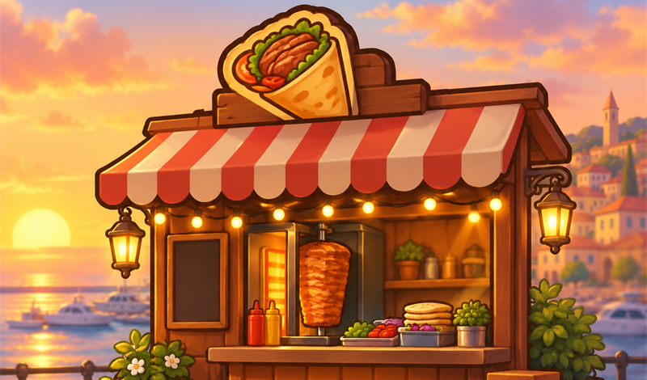
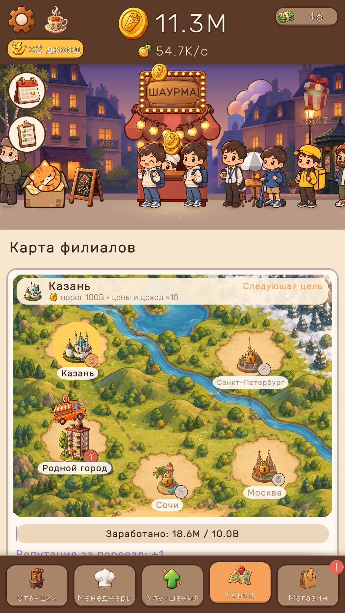
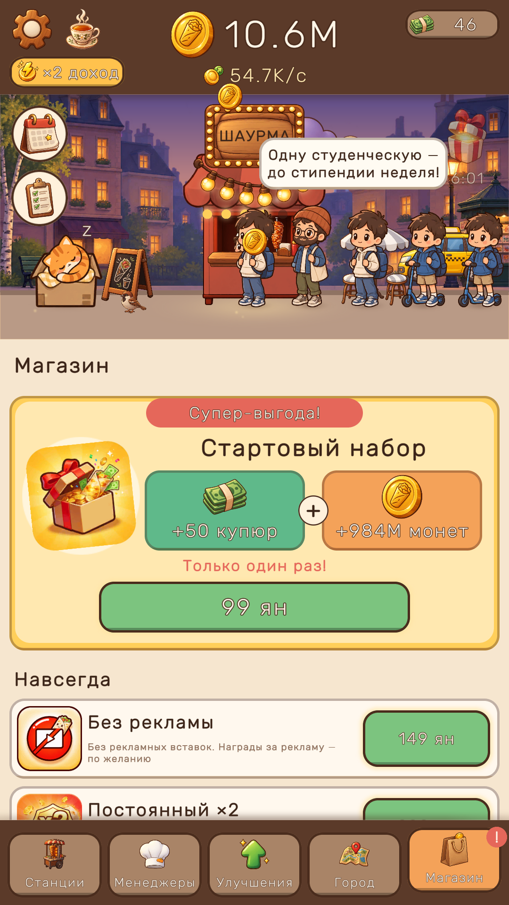

# Шаурма Тайкун / Shawarma Tycoon



«Шаурма Тайкун» — уютный idle-тайкун для [Яндекс Игр](https://yandex.ru/games/). Игрок начинает с одного ларька шаурмы и превращает его в сеть по пяти городам: Родной город → Казань → Сочи → Санкт-Петербург → Москва.

- **Жанр:** idle / clicker / tycoon
- **Платформы:** Яндекс Игры (WebGL), десктоп и мобильные, портрет и альбом
- **Языки:** русский, английский
- **Движок:** Unity 2022.3.62f1, URP 2D

## Возможности

- **Станции.** Шесть станций в каждом городе (от «Шаурмы классик» до «Гриль-тарелки»), покупка ×1 / ×10 / ×Max, вехи уровней ускоряют цикл.
- **Менеджеры и улучшения.** Менеджер автоматизирует станцию, улучшения умножают доход.
- **Офлайн-доход.** Ларёк зарабатывает, пока игрока нет.
- **Престиж.** Открытие филиала в новом городе даёт репутацию: +2% к доходу навсегда. Есть магазин репутации.
- **Купюры.** Премиум-валюта для станций, улучшений и менеджеров, её дают за рекламу и покупки.
- **Удержание.** 7-дневный календарь наград, три ежедневных задания, лидерборд «Самая богатая сеть».
- **Онбординг.** Рука-подсказка в первые минуты игры.
- **Атмосфера.** Вечерний город, кот Лаваш, погода (дождь, снег), эмбиент, lo-fi-музыка и режим любования (zen).
- **Монетизация.** Rewarded-бусты, межстраничная реклама с ограничением частоты, покупки за яны: наборы купюр, стартовый пак, «Без рекламы», «Постоянный ×2».

| | | |
|---|---|---|
|  |  |  |

## Быстрый старт

1. Установите **Unity 2022.3.62f1** через Unity Hub с модулем **WebGL Build Support**.
2. Откройте папку проекта в Unity Hub.
3. Откройте сцену `Assets/_Game/Scenes/Boot.unity` и нажмите Play. Play Mode всегда стартует с Boot (`PlayModeStartScene`).

Если после клона UI или ассеты выглядят пустыми, пересоберите их через меню:
`ShaurmaTycoon/Setup Project` → `ShaurmaTycoon/Art/Build Sprite Atlases` → `ShaurmaTycoon/Build Game UI`.

## Структура проекта

```
Assets/
  _Game/
    Scripts/        код игры (сборка ShaurmaTycoon)
      Core/         GameBootstrap, TickManager, Services, события
      Economy/      Wallet, EconomyMath, BigNumberFormatter
      Stations/     конфиги, модель и контроллер станций
      Managers/ Upgrades/ Customers/ Prestige/ Offline/
      Retention/    ежедневные награды и задания
      Onboarding/   туториал
      Shop/ Ads/    купюры, покупки, реклама
      Save/         сохранения, миграции, облачные сейвы
      Platform/     IPlatformService: редактор и Яндекс Игры
      Localization/ ru/en
      Ambient/ UI/
      Editor/       инструменты редактора и релизная сборка
    Configs/        ScriptableObject-ассеты баланса, городов, магазина
    Tests/EditMode/ EditMode-тесты
    Plugins/WebGL/  YandexBridge.jslib — мост к Yandex Games SDK
    Scenes/         Boot, Game
  WebGLTemplates/YandexGames/   шаблон страницы с подключением SDK
  StreamingAssets/Audio/        музыка и эмбиент в MP3 (догружаются после старта)
Docs/               дизайн, план, прогресс, релиз
Tools/YandexDebugChecker/       чекер требований модерации (в релиз не попадает)
```

Логика (модели, экономика, сохранения) написана на чистом C# и отделена от MonoBehaviour-представлений. Системы общаются через C#-события и `Services`.

## Тесты

Window → General → **Test Runner** → вкладка **EditMode** → Run All.

Тесты покрывают экономику и форматирование чисел, станции, менеджеры, улучшения, престиж, офлайн-доход, сохранения и миграции, магазин и покупки, удержание, туториал, локализацию и релизные проверки.

## Сборка для Яндекс Игр

В редакторе выполните `ShaurmaTycoon/Release/Build Yandex (WebGL)`. Команда переключит платформу на WebGL, выставит релизные настройки, прогонит Preflight-проверки модерации и соберёт:

- `Builds/Yandex/`: билд;
- `Builds/Yandex.zip`: архив для консоли разработчика (`index.html` в корне);
- `Builds/Yandex_size_report.txt`: отчёт о размере.

Сборка без открытого редактора:

```bash
"C:\Program Files\Unity\Hub\Editor\2022.3.62f1\Editor\Unity.exe" -batchmode -quit -projectPath . -buildTarget WebGL -executeMethod ShaurmaTycoon.EditorTools.YandexRelease.BuildFromCommandLine -logFile Builds/build.log
```

Отладочная сборка с чекером модерации: `ShaurmaTycoon/Release/Build Yandex Debug (checker)` → `Builds/YandexDebug`.

Настройка консоли (покупки, лидерборд, облачные сохранения), тексты черновика и чек-лист модерации описаны в [Docs/Release/YANDEX_RELEASE.md](Docs/Release/YANDEX_RELEASE.md).

## Полезные меню редактора

| Меню | Что делает |
|---|---|
| `ShaurmaTycoon/Setup Project` | Создаёт и настраивает конфиги и сцены |
| `ShaurmaTycoon/Build Game UI` | Генерирует UI игрового экрана |
| `ShaurmaTycoon/Art/*` | Иконки, UI-спрайты, атласы |
| `ShaurmaTycoon/Balance/Simulate Cities` | Симуляция баланса по городам |
| `ShaurmaTycoon/Save/*` | Печать и удаление сейва, сдвиг времени для проверки офлайна и ежедневок |
| `ShaurmaTycoon/Release/Preflight Check` | Проверка требований модерации без сборки |
| `ShaurmaTycoon/Release/Encode Web Audio (MP3)` | Перекодирует музыку и эмбиент в MP3 (нужен ffmpeg) |

## Документация

- [GDD](Docs/GDD.md): геймдизайн, формулы экономики, монетизация
- [PLAN](Docs/PLAN.md): архитектура и этапы разработки
- [PROGRESS](Docs/PROGRESS.md): журнал выполненных этапов
- [ART_DIRECTION](Docs/Visual/ART_DIRECTION.md): визуальный стиль «уютный вечер у ларька»
- [YANDEX_RELEASE](Docs/Release/YANDEX_RELEASE.md): релиз на Яндекс Играх

## Авторы ресурсов

Звуки, музыка, персонажи и шрифты распространяются под CC0 и SIL OFL. Полный список: [Assets/_Game/CREDITS.md](Assets/_Game/CREDITS.md).
